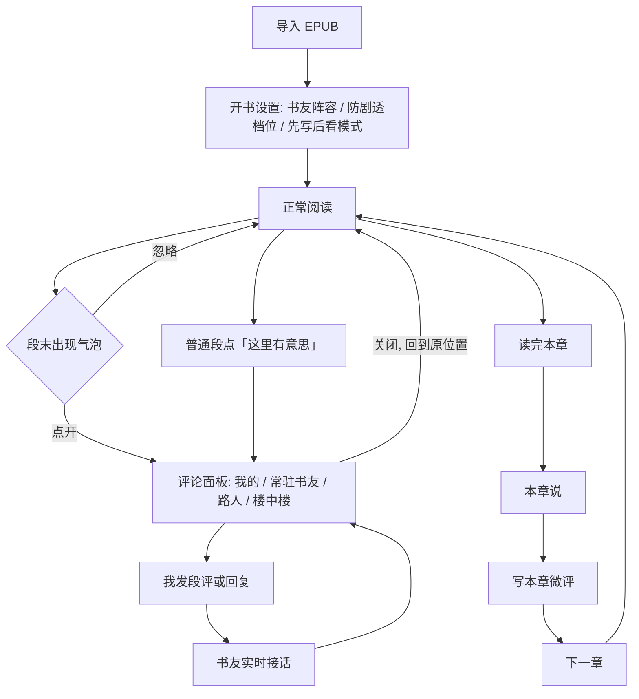
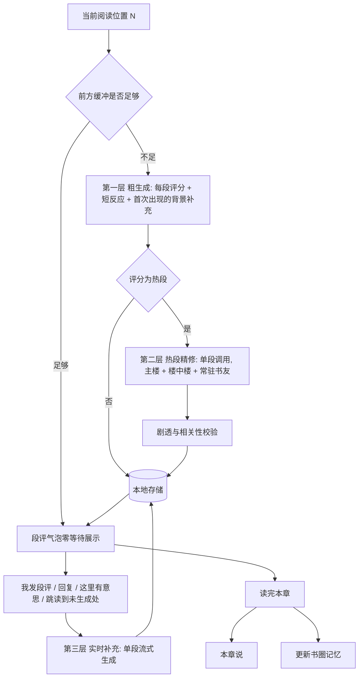

# 书友席（Reader Seat）V2 产品设计

> 让每一部名著，都有一群陪你读到这一页的书友。

- 版本：0.2（在 V1「AI 虚拟读者评论系统」基础上重新定义）
- 状态：设计定稿前讨论版 / 自用验证阶段
- 日期：2026 年 11 月
- 关联文档：[V1 产品文档](AI虚拟读者评论系统_V1产品文档.docx)、[世界文学十年阅读与评论输出计划](reading_plan.md)

---

## 0. 一页概览

| 项目 | V2 定义 |
| --- | --- |
| 一句话定义 | 一个陪你读名著的虚拟书友评论区。一群 AI 书友和你同步读到这里，他们吐槽、争论、猜后文、给人物起外号，也会回复你写下的段评。 |
| 要解决的问题 | 名著慢热、门槛高、独自阅读缺少即时反馈，导致读得枯燥、容易中断。 |
| 产品形态 | 纯客户端 App（Tauri 2 打包 Android、macOS、Windows），无后端；本地优先，用户自带 EPUB。 |
| 核心体验 | 段评气泡零等待：读到名场面时，评论区已经热闹起来了。 |
| 评论来源 | 纯 AI，显著标注；不做真人社区，不伪造热度。 |
| 书友结构 | 3 到 5 位跨全书的常驻书友（有记忆、有立场）加上每段随机出现的路人书友。 |
| 生成机制 | 段落锚定展示 + 滚动预生成 + 热段精修 + 实时补充。 |
| 首要用户 | 产品作者本人，用于执行十二站名著阅读计划；验证有效后再考虑面向他人。 |
| 成功标准 | 阅读计划能持续推进：阅读天数和时长上升，「读不下去」的时刻被评论区拉回来。 |

### 本版不做什么

- 不做真人社区、关注、公开评论广场。评论跟着段落走，而作者没有内容版权，也没有运营社区的能力。
- 不提供书库，不分发作品，不绕过 DRM。用户只导入自己合法持有的 EPUB。
- 不伪造社会证明：不显示虚构的点赞数、在线人数、「3 小时前」之类的时间戳。
- 不做 AI 问答助手，也不把自动摘要、知识图谱当作功能提供给用户（前文摘要只在内部用作生成上下文）。背景知识通过评论区里的书友自然带出。
- 不追求每段都有评论。普通过渡段允许没有评论。

---

## 1. 背景：名著为什么读不下去

### 1.1 名著阅读的四个痛点

| 痛点 | 表现 | 网文为什么没有这个问题 |
| --- | --- | --- |
| 慢热 | 前几十页在铺陈，刺激点稀疏，奖励来得晚。 | 网文刻意高频制造爽点，每章都有钩子。 |
| 门槛 | 俄国小说人名多、历史背景陌生、翻译腔，读着读着就迷路了。 | 网文的语境就是读者的当下生活。 |
| 孤独 | 读到妙处没人可说，读到困惑没人可问。 | 起点段评里永远有人和你同时读到这里。 |
| 无反馈 | 自己的理解对不对、别人怎么看，都无从得知。 | 评论区就是即时的群体反馈。 |

### 1.2 起点评论区好玩在哪里

评论区的乐趣不来自任何一条评论写得多好，而来自以下几种**氛围机制**：

1. **段评气泡**：没点开就知道「这里有梗、有人在吵」，制造好奇心。
2. **楼中楼互怼**：评论之间会接话、会争论，而不是各说各的。
3. **评论区文化**：给人物起外号、反复使用的黑话、大家都记得的名场面。
4. **伏笔回收**：「前面说 XX 是好人的出来挨打」，评论区有集体记忆。
5. **被回复的快感**：你发的段评有人接话。

V1 为了克制，几乎排除了上述全部机制：只按需生成、评论彼此独立、没有固定读者、不做弹幕。结果是一个合格的「评论生成工具」，但缺少「不是一个人在读」的氛围。

### 1.3 V2 的方向

仍然纯 AI、仍然透明标注、内容仍由用户自带，**但把氛围机制找回来**，并且只为文学作品（小说、戏剧）设计。

---

## 2. 定位与设计原则

### 2.1 定位

书友席不是阅读助手，也不是聊天机器人。它模拟的是一个「正在和你同步读这本书的评论区」：

- 用户是这个评论区里的一员，可以围观，也可以发言。
- 书友是 AI 扮演的虚拟读者，有的从头陪到尾，有的只是路过。
- 评论区有自己的记忆和文化，会随着阅读进度一起成长。

### 2.2 设计原则

| 原则 | 解释 | 落地要求 |
| --- | --- | --- |
| 氛围优先 | 目标是「不是一个人在读」，而不是信息完整。 | 气泡、楼中楼、外号、伏笔回收优先于背景知识的完整性。 |
| 刺激点即刻响应 | 读到有趣处想立刻看反应，等待会消耗刺激。 | 评论提前生成，点开零等待；实时生成首条在 1 到 2 秒内出现。 |
| 书友有记忆 | 陪伴感来自连续性。 | 常驻书友记得自己的预测和立场；书圈记忆在全书延续。 |
| 只知道已读内容 | 书友和你一样是初读者（老书虫除外，且受限）。 | 上下文只含已读内容，提示词约束加生成后自检。 |
| 先读者，后书友 | 不能用 AI 评论替代自己的判断。 | 提供先写后看模式，与阅读计划的「读时只批注」对齐。 |
| 阅读是主流程 | 评论区是增强层，不能喧宾夺主。 | 气泡轻量；评论面板不遮挡正文、不导致阅读位置跳动；弹幕模式默认关闭。 |
| 透明 | 纯 AI，不伪装真人。 | 显著标注「AI 书友」；不伪造热度数据。 |

---

## 3. V1 到 V2 的变更说明

### 3.1 舍弃或收缩

| V1 设计 | V2 处理 | 理由 |
| --- | --- | --- |
| 面向通用文档（小说、非虚构、学习资料） | 只聚焦文学作品（小说、戏剧） | 防剧透、人物记忆、外号文化都需要围绕叙事做专门设计；泛化会让每个场景都做不深。 |
| 用户点击才生成评论 | 改为段落锚定展示 + 滚动预生成 | 点开才生成要等 5 到 15 秒，刺激点会被等待消耗；也无法显示段评气泡。 |
| 风格三档（均衡 / 轻松 / 认真） | 用「书友阵容」代替 | 评论风格由「谁在读」决定，比一个抽象滑杆更自然。 |
| 评论彼此独立，不展开楼中楼 | 热段预生成楼中楼 | 争论是评论区乐趣的主要来源。 |
| 评论者全部随机，不跨段落持续 | 常驻书友 + 路人书友双层结构 | 陪伴感和伏笔回收需要连续的身份和记忆；随机路人保留新鲜感。 |
| 15 到 20 人外部用户实验 | 先做作者本人的自用验证 | 首要用户就是作者本人；先证明它能帮自己读完名著。 |
| 6 字段复杂缓存键 | 简化为「书 + 章节 + 段落 + 批次」，附提示词版本 | 单人本地使用，不需要跨用户共享缓存。 |
| 「自动弹幕」列为不做 | 改为可选的弹幕氛围模式，默认关闭，不覆盖正文 | 弹幕是氛围的一种形态，但必须不干扰阅读。 |

### 3.2 新增

| 新增功能 | 一句话说明 |
| --- | --- |
| 段评气泡与热段 | 段落末尾显示真实评论数，热段更显眼。 |
| 楼中楼 | 热段里的书友会互相接话、争论。 |
| 常驻书友 | 3 到 5 位跨全书的书友，有稳定口吻、立场和记忆。 |
| 老书虫 | 一位重读者，在防剧透允许的范围内给出暗示。 |
| 书圈记忆 | 外号表、名场面、预测台账、争议话题，在全书延续。 |
| 我的段评 | 用户发的段评出现在评论区，由相关书友接话。 |
| 先写后看模式 | 先写自己的反应，再解锁书友评论。 |
| 本章说 | 章末评论区：本章反应汇总、争议、对下一章的预测。 |
| 「这里有意思」 | 用户标记模型判断为普通、但自己觉得有意思的段落，触发实时生成并校准之后的判断。 |
| 输出导出 | 批注、段评、微评导出为 Markdown，直接进 Obsidian。 |

### 3.3 保留并调整

| V1 设计 | V2 调整 |
| --- | --- |
| 可评论性决定评论密度 | 保留。由粗生成阶段评分，热段再精修加量；用户的「这里有意思」可覆盖模型判断。 |
| 小说防剧透 | 扩展为三档，并单独处理「大模型本身就知道名著情节」的问题。 |
| 显著标注 AI 生成 | 保留。允许昵称、头像、楼中楼，但不伪造时间戳和热度。 |
| 回复某条评论 | 保留，并扩展为「我发段评，书友接话」。 |
| 缓存保证体验稳定 | 保留。重开同一段看到同一批评论，只有主动「换一批」才变化。 |
| 本地优先、最小上下文上云 | 保留。书籍文件不上传，只发送生成所需的已读片段。 |

---

## 4. 书友系统

### 4.1 双层结构

| 层级 | 数量 | 持续性 | 作用 |
| --- | --- | --- | --- |
| 常驻书友 | 每本书 3 到 5 位 | 跨全书持续，有记忆 | 陪伴感、站队、预测与伏笔回收、外号文化。 |
| 路人书友 | 每段 0 到 4 位 | 仅出现在当前段，不保留记忆 | 新鲜感、不可预测性，避免评论区只有几张老面孔。 |

评论区的感觉应该是「几个熟面孔加上一群路过的人」。常驻书友不是每段都出现：每段最多 2 位常驻书友发言，其余由路人补位，按段落内容决定谁该说话。

### 4.2 默认常驻阵容

阵容是一组「职能」，不是用户必须挑选的人格。每本书开书时使用默认阵容，用户可以关掉某一位或调整其出场频率。

| 书友 | 读者类型 | 典型发言方式 | 在评论区里的职能 | 出场时机 |
| --- | --- | --- | --- | --- |
| 头回读 | 第一次读这本书的普通读者 | 情绪外露、代入感强、爱站队、爱猜后文 | 情绪共鸣、做预测（之后被回收） | 情节转折、人物抉择、情绪高点 |
| 课代表 | 文学细读爱好者 | 短而准，指出叙述技巧，但说人话 | 细读示范，用到阅读计划词汇表里的工具（如自由间接引语、反讽、潜文本） | 叙述手法明显的段落 |
| 考据癖 | 历史和翻译爱好者 | 「冷知识」口吻，一两句点到为止 | 降低门槛：时代背景、人名关系、典故、译本差异 | 人名、地名、典故**首次出现**时，或明显的理解难点 |
| 毒舌 | 吐槽型读者 | 反讽、玩梗、给人物起外号 | 笑点和外号文化的主要来源；常和「头回读」抬杠 | 人物言行荒唐、虚伪、矛盾处 |
| 老书虫 | 重读者，知道全书 | 克制的暗示，从不直说 | 制造期待感：「这句话记住，后面要考」 | 关键伏笔处，受防剧透档位约束（见第 9 节） |

常驻书友之间预设少量关系，例如「毒舌」和「头回读」是冤家，前者泼冷水、后者护主角，为楼中楼提供自然的冲突来源。关系只用于让争论有来由，不制造为了吵而吵的对立。

### 4.3 常驻书友的设定与状态

每位常驻书友由两部分组成：

**固定设定**（开书时确定，全书不变）

- 昵称、头像（固定的几何图形或字母头像）。
- 口吻样本：3 到 5 句示范发言，用来稳定语气。
- 关注点：最容易被哪类内容触发。
- 禁区：例如「考据癖」不长篇讲课，「老书虫」不直接说出后文。

**动态状态**（随阅读进度更新，存于书圈记忆）

- 站队：喜欢或讨厌哪些人物，以及原因。
- 未结预测：说过哪些对后文的猜测，尚未验证。
- 发言摘要：最近说过的关键观点，避免自相矛盾或重复。
- 与「我」的交互：用户和这位书友聊过什么、观点上同意或分歧在哪里。

### 4.4 路人书友

路人每段随机采样，沿用 V1 的四个采样维度，保证同一段里的路人彼此不同：

| 维度 | 示例 |
| --- | --- |
| 反应方式 | 情绪反应、吐槽、疑问、联想、补充、质疑、预测、短评 |
| 观点关系 | 赞同、反对、部分认同、替代解释 |
| 表达风格 | 简短口语、认真分析、幽默、感性、克制 |
| 背景视角 | 不同的阅读经验、生活经验、对作品的熟悉度（都只作写作视角，不虚构真实身份） |

路人不保留记忆。但如果某位路人的说法在评论区「出圈」，比如起了一个好外号，可以作为评论区文化写进书圈记忆，之后由常驻书友引用（「上次有人管他叫 XX，我觉得挺贴切」）。

### 4.5 楼中楼

- 只在热段出现，由热段精修预生成。
- 每楼最多 1 到 2 层、3 条回复，不做 AI 之间的无限辩论。
- 回复类型：反驳、补充、玩梗接龙、站队、伏笔回收提醒。
- 用户加入某一楼后，这一楼才继续往下展开，由被回复的书友和相关书友接话。

### 4.6 我的段评与书友回复

这是「被回复的快感」的来源，比 V1 的「回复某条 AI 评论」更接近真实评论区。

1. 用户在任意段落发一条段评，它以「我」的身份出现在该段评论区，位置在最上方。
2. 系统选 1 到 2 位书友接话。选择规则：优先选与用户观点相反或互补的常驻书友，其次是该段已发言的路人。
3. 回复实时流式生成，首条在 1 到 2 秒内出现。
4. 用户可以 @ 某位常驻书友，指定由他回复。
5. 用户也可以直接回复任意一条已有评论，与这条评论背后的书友继续对话（沿用 V1 第 6 节的线程机制）。
6. 用户的段评会写入相关书友的「与我的交互」状态。之后的章节里，书友可能会提起：「你之前说于连是在演戏，现在看来你说对了一半。」

### 4.7 评论区示例

以下为示意，评论内容为原创示例，不代表最终风格。场景是《老人与海》开篇，老人连续多日没有捕到鱼。

> **段评（7）**
>
> **头回读**（常驻）：八十多天一条鱼都没有……换我早改行了，老头是真的倔。
> - **毒舌**（常驻）：倔是好听的说法。补丁摞补丁的帆被写成失败的旗子，作者开篇就把基调挂在桅杆上了。
> - **头回读**（常驻）：别咒他！我赌他这次能钓到大的。
>
> **考据癖**（常驻）：古巴渔民当时多用手钓、靠洋流，出海越远风险越大，后面「出远海」这件事分量很重。
>
> **路人·读第三遍的**：开头没有一句煽情，全是事实，冰山理论的教科书示范。
>
> **我**：男孩被父母叫走那段，我反而觉得比没鱼更惨。
> - **课代表**（常驻）：同意，作者没写老人难过，只写了男孩帮他搬东西，情绪全在动作里。
>
> 标注：以上评论均由 AI 书友生成。

---

## 5. 书圈记忆

书圈记忆是一本书的「评论区集体记忆」，让外号、梗和预测在全书延续。它只包含已读内容，每次生成评论都会带上它。

### 5.1 内容结构

| 条目 | 内容 | 示例用途 |
| --- | --- | --- |
| 前文摘要 | 已读章节的滚动摘要，每章一两百字 | 提供上下文，同时控制长度 |
| 人物外号表 | 人物、外号、起源段落、起名者 | 外号在全书反复使用，形成评论区文化 |
| 名场面 | 已读的高光段落及其一句话标签 | 后文呼应时可以「梦回第 X 章」 |
| 预测台账 | 预测内容、预测者、提出位置、状态（待验证 / 应验 / 打脸） | 伏笔回收：「前面说 XX 的出来挨打」 |
| 争议话题 | 书友之间尚未结束的争论及各方立场 | 楼中楼的冲突来源，后续情节可以「补刀」 |
| 书友状态 | 每位常驻书友的站队、未结预测、与我的交互 | 保持人设和记忆连续 |
| 我的立场 | 用户段评中表达过的主要观点 | 书友回应和后续提起 |

### 5.2 更新时机

- **热段精修后**：如果产生了新外号、新预测或新争议，立即写入。
- **章末**：生成本章说时，同步做一次整理，包括更新前文摘要、合并重复条目、判定已有预测是否已在本章应验或被推翻。
- **用户发段评后**：更新「我的立场」和相关书友的交互状态。

### 5.3 伏笔回收如何触发

1. 粗生成时，把预测台账里状态为「待验证」的条目一并发给模型。
2. 模型判断当前段落是否明确应验或推翻了某条预测，判断只能基于已读文本。
3. 如果命中，这一段自动视为热段，精修时由预测者本人或其他书友点出来（「头回读：好吧，我认，我前面说错了」）。
4. 预测台账状态更新。

### 5.4 用户可见与可编辑

提供一个「书圈档案」页面，用户可以查看外号表、名场面和预测台账，也可以删改不喜欢的外号或错误的条目。这一页本身也是阅读回顾，适合在写正式评论之前翻一翻。

---

## 6. 核心用户流程与界面

### 6.1 主流程



### 6.2 阅读界面

- **正文**：EPUB 渲染，支持字体、字号、行距、主题（含夜间）设置，记忆阅读位置。
- **段评气泡**：段落末尾的小气泡，显示该段实际评论数。
  - 普通段：浅色小号数字。
  - 热段：气泡加深、加粗，带「热」字标记。
  - 没有评论的段落不显示气泡，长按段落可以调出「这里有意思」。
  - 先写后看模式下，气泡显示数字和锁形图标。
- **评论面板**：
  - 手机：底部半屏抽屉，被评论的段落在上方保持可见并高亮。
  - 桌面：右侧栏，正文不移动。
  - 关闭面板后，阅读位置不变。
- **评论排序**：我的段评、常驻书友、路人。楼中楼默认展开前 2 条，其余折叠。
- **面板操作**：发段评、回复某条、@ 常驻书友、换一批（只换路人）、收藏某条评论、标记「无聊 / 剧透 / 错误」。
- **AI 标注**：面板顶部固定显示「以下评论由 AI 书友生成」，常驻书友名字旁带「常驻」标记。

### 6.3 弹幕氛围模式（可选，默认关闭）

- 不在正文上方覆盖文字。
- 当热段滚动进入视野时，屏幕底部的细条里浮现一条书友短反应，停留约 3 秒后淡出。
- 同一屏最多一条，阅读速度快时自动跳过。
- 点击浮现的反应直接打开该段评论面板。
- 适合不想频繁点气泡、只想感受「旁边有人」的阅读状态。

---

## 7. 生成机制：段落锚定 + 滚动预生成 + 热段精修 + 实时补充

### 7.1 两个维度要分开

- **展示粒度**：始终是段落，即起点段评的形态。
- **生成时机**：提前生成，而不是点开后才生成。

起点段评「立刻就有」，是因为评论在你读到之前就已经存在。点开才逐段生成要等 5 到 15 秒，刺激点会被等待消耗掉。

但整章一次性批量生成也不可取：

- 单个刺激点被稀释：一次调用摊到上百段，名场面的评论会偏浅。
- 章内剧透：模型看过整章，第 5 段的评论可能泄露第 50 段的内容。
- 浪费：会为跳读的段落也生成评论。

### 7.2 三层机制



**第一层：滚动粗生成**

- 以当前阅读位置为准，后台保持前方约 15 段已生成。缓冲少于 8 段时生成下一块。
- 分块按字数而不是按段数：一块约 1500 到 3000 字，对话密集时段数会多一些。
- 每块一次结构化调用，输出：
  - 每段的可评论性评分（0 到 3）。
  - 评分为 1 或 2 的段落：1 到 3 条短反应。
  - 人名、地名、典故**首次出现**的段落：一条「考据癖」补充，在读者困惑之前就到位。
  - 预测台账命中判断（见 5.3）。
- 约束：评论第 i 段的书友只读到第 i 段。

**第二层：热段精修**

- 评分为 3 的段落单独再调用一次，全部注意力只给这一个刺激点。
- 输出：4 到 6 条主楼评论、1 到 2 组楼中楼、常驻书友结合书圈记忆的反应（使用外号、回收预测、延续争议）。
- 按距离阅读位置由近到远排队，最多 2 个并发。
- 热段配额：每块最多 2 个热段，大约占全书段落的 5% 到 10%。配额让「热」保持稀缺，也控制成本。

**第三层：实时补充**

| 触发场景 | 生成内容 |
| --- | --- |
| 跳读或打开到尚未生成的位置 | 当前段实时生成，同时从新位置重建前方缓冲 |
| 普通段点「这里有意思」 | 按热段规格实时生成，并记录这次反馈 |
| 我发段评 | 1 到 2 位书友接话 |
| 我回复某条评论 | 被回复的书友继续对话 |
| 换一批 | 重新生成该段的路人评论，常驻书友的发言保持不变 |

实时生成全部流式输出，首条评论目标在 1 到 2 秒内出现。

### 7.3 评分与密度

| 评分 | 含义 | 生成量 | 示例 |
| --- | --- | --- | --- |
| 0 | 过渡、交代 | 不生成 | 场景切换、简单动作 |
| 1 | 有一点可说 | 0 到 1 条短反应 | 一个有意思的细节 |
| 2 | 值得一谈 | 2 到 3 条 | 人物行为、明确观点、叙述技巧 |
| 3 | 热段 | 精修：4 到 6 条主楼加楼中楼 | 反转、情绪爆发、名场面、伏笔回收 |

用户的「这里有意思」和「无聊」标记会作为少量示例写进之后的粗生成提示词，让评分逐渐贴近用户自己的口味。

### 7.4 缓存与稳定性

- 缓存键：书 ID + 章节 ID + 段落锚点 + 批次号，附带提示词版本。
- 重开同一段，默认看到同一批评论；只有主动「换一批」才变化，旧批次保留可翻看。
- 换一批有频率限制，例如每段每天 3 次。
- 已读过的章节回看时直接读缓存，不重新生成。

### 7.5 失败与回退

- 生成失败不影响阅读：该段不显示气泡，后台自动重试一次。
- 实时生成失败时，面板显示重试按钮。
- 网络不可用时，已缓存的评论照常可看，未生成的段落静默跳过。

---

## 8. 本章说

章末出现「本章说」入口，是评论区的额外一层，不替代段评。

### 8.1 内容

- **本章热段**：列出本章 2 到 3 个热段，点击跳回原段。
- **常驻书友一句话**：每位常驻书友对本章的一句总结，口吻延续人设。
- **争议汇总**：本章出现的主要分歧，各方立场一句话。
- **预测更新**：本章新增的预测，以及应验或被打脸的旧预测。
- **微评提示**：邀请用户写本章微评，格式沿用阅读计划：一个判断、一个文本证据、一个保留。

### 8.2 微评之后

用户提交微评后，1 到 2 位常驻书友回应，可能是认同、补充证据，或者指出「保留」部分可以更尖锐。微评同时进入导出内容（见第 10 节）。

---

## 9. 防剧透

### 9.1 三档设置

| 档位 | 适用 | 常驻书友 | 老书虫 | 考据癖 |
| --- | --- | --- | --- | --- |
| 严格（初读默认） | 第一次读 | 只知道已读内容 | 不发言 | 只讲与已读内容相关的背景，不提作者如何安排后文 |
| 可暗示 | 想要期待感的初读 | 只知道已读内容 | 只能暗示「重要性」，不能暗示「方向」 | 同上 |
| 全开放 | 重读 | 所有书友都按重读者发言，可以谈结局和全书结构 | 自由发言 | 可以谈全书背景和创作史 |

「重要性」和「方向」的区别举例：

- 允许：「这句话记住，后面要考。」「这个人物的出场方式值得留意。」
- 不允许：「他后面会死。」「这人不可信。」「这里埋了一个悲剧的种子。」

### 9.2 剧透的两个来源与对策

**来源一：上下文泄露**（模型看到了读者还没读的文本）

- 只发送已读内容和当前块文本，块内用段落编号约束「评论第 i 段只能用到第 i 段」。
- 规则校验：提取当前块中第 i 段之后才首次出现的人名、地名，如果出现在第 i 段的评论里，直接丢弃这条评论。
- 不把书籍的序言、译者前言、内容简介作为上下文，这些地方经常直接剧透。

**来源二：模型先验**（大模型本来就熟悉名著情节，这是名著场景特有的风险）

- 提示词里明确设定书友是初读者，只能依据提供的文本说话，禁止引用文本之外的情节。
- 每条评论输出一个 `uses_outside_plot` 自报字段，自报为真的直接丢弃。
- 热段精修后追加一次校验调用：「以下评论是否提及或暗示了所给文本之外的情节」，不通过的评论丢弃。
- 用户标记「剧透」的评论会被隐藏，并作为反例写入之后的提示词。

---

## 10. 先写后看模式与阅读计划衔接

### 10.1 为什么需要这个模式

阅读计划的固定流程要求「读时只批注，不查任何评论」「写微评时不看评论」。AI 评论如果先出现，会替代用户自己的判断。先写后看模式让产品成为计划流程的一环，而不是和计划冲突。

### 10.2 三种模式（按书设置）

| 模式 | 规则 | 适用 |
| --- | --- | --- |
| 关闭 | 评论随时可看 | 只想读得轻松，或者重读 |
| 逐段先写后看 | 气泡显示数字和锁，先在该段写一句反应或批注，才能解锁该段评论 | 想保留独立判断，又想要即时反馈 |
| 章末解锁 | 整章读完、写完本章微评之后，才解锁本章全部段评和本章说；之后可以「带评论二刷」本章 | 最严格地执行计划流程 |

锁着的气泡本身也是动力：知道这里有人在吵，就更想先写下自己的看法。

### 10.3 批注与输出导出

- 用户内容分三类：划线批注、段评、本章微评。
- 每本书可以导出为一个 Markdown 文件，直接放进 Obsidian：

```markdown
---
book: 红与黑
translator: 罗新璋
station: 2
exported: 2026-11-04
---

## 第一章

### 我的批注
- 「……」（段落开头 20 字以内）：我的批注内容

### 我的段评
- 我的段评内容
  - 课代表：书友回复（可选是否导出）

### 本章微评
判断：……
证据：……
保留：……
```

- 导出只引用每段开头的短片段作为定位，不导出大段原文。
- 书籍可以标注属于阅读计划的第几站，便于之后按站整理正式评论。

---

## 11. 功能清单

优先级对应版本规划：Must 为阶段 1（MVP），Should 为阶段 2，Later 为阶段 3。

| 模块 | 需求 | 优先级 |
| --- | --- | --- |
| 书籍导入 | 导入本地 EPUB，解析书名、作者、章节、段落 | Must |
| 阅读器 | 滚动阅读、章节目录、字体字号行距、夜间主题、阅读位置记忆 | Must |
| 段落锚定 | 每段稳定锚点，评论绑定到段落 | Must |
| 开书设置 | 书友阵容（默认阵容，可关闭某位）、防剧透档位 | Must |
| 滚动粗生成 | 前方缓冲、分块调用、评分、短反应、首次出现的背景补充 | Must |
| 热段精修 | 单段调用、主楼加楼中楼、常驻书友记忆反应、热段配额 | Must |
| 段评气泡 | 真实评论数、热段样式 | Must |
| 评论面板 | 手机底部抽屉 / 桌面侧栏、排序、楼中楼折叠、AI 标注 | Must |
| 我的段评 | 发段评、书友实时流式接话、@ 常驻书友 | Must |
| 回复评论 | 回复任意评论，线程内多轮对话 | Must |
| 书圈记忆 | 前文摘要、外号表、预测台账、争议、书友状态的生成与更新 | Must |
| 防剧透 | 三档设置、块内段落约束、规则校验、自报字段 | Must |
| 评论反馈 | 收藏、标记无聊 / 剧透 / 错误 | Must |
| 失败回退 | 生成失败不影响阅读、重试 | Must |
| 本地数据 | 全部数据存本地，支持删除某本书的所有数据 | Must |
| 本章说 | 热段、书友一句话、争议汇总、预测更新、微评提示 | Should |
| 先写后看 | 逐段先写后看、章末解锁、带评论二刷 | Should |
| 这里有意思 | 普通段标记、实时生成、反馈校准评分 | Should |
| 换一批 | 只换路人，频率限制，旧批次可翻看 | Should |
| 划线批注 | 选中文字批注 | Should |
| Markdown 导出 | 批注、段评、微评导出到 Obsidian | Should |
| 书圈档案页 | 查看和编辑外号、名场面、预测台账 | Should |
| 弹幕氛围模式 | 底部细条浮现热段短反应，默认关闭 | Should |
| 热段二次校验 | 精修后的剧透与相关性校验调用 | Should |
| 成本面板 | 每本书、每天的调用量和花费 | Should |
| 分页阅读 | 翻页模式下的气泡与面板 | Later |
| 跨书记忆 | 常驻书友跨书延续，能联系之前读过的书（对应阅读计划的站间对照） | Later |
| 译本对读 | 同一作品两个译本的段落对齐，书友讨论译法差异 | Later |
| 书友自定义 | 调整常驻书友设定、增加新书友 | Later |
| 阅读计划面板 | 十二站进度、每站输出任务清单 | Later |
| 数据备份 | 本地数据导出 / 导入 JSON，跨设备迁移 | Later |
| 真人社区、公开评论 | 无内容版权，不做 | 不做 |
| 在线书库 | 无内容版权，不做 | 不做 |
| AI 问答、自动摘要 | 与产品定位不符，不做 | 不做 |

---

## 12. 数据对象

概念级定义，全部存储在本地 IndexedDB。

| 对象 | 关键字段 | 说明 |
| --- | --- | --- |
| Book | id、title、author、translator、fingerprint、station、spoiler_level、unlock_mode、lineup_config、created_at | 书籍及开书设置；station 为阅读计划站点 |
| Chapter | id、book_id、order、title、read_status、summary | summary 只在读完后生成 |
| Paragraph | id、chapter_id、order、anchor、text_hash、score、gen_status、user_marked | gen_status：未生成 / 粗生成 / 已精修；user_marked：这里有意思 / 无聊 |
| ResidentReader | id、book_id、role、display_name、avatar、voice_samples、focus、taboos、relations、stances、recent_points、user_interactions | 常驻书友的固定设定和动态状态 |
| BookMemory | book_id、nicknames、highlights、debates、user_stances、updated_at | 书圈记忆中除预测以外的部分 |
| Prediction | id、book_id、reader_id、content、made_at_paragraph、status、resolved_at_paragraph | 预测台账；status：待验证 / 应验 / 打脸 |
| CommentBatch | id、paragraph_id、layer、batch_no、prompt_version、model、created_at | layer：粗生成 / 精修 / 实时 |
| Comment | id、batch_id、paragraph_id、parent_id、author_type、reader_id、display_name、avatar、text、reaction_type、stance、uses_outside_plot、user_flags | author_type：常驻 / 路人 / 我；parent_id 用于楼中楼；路人的身份信息直接存在评论上 |
| UserNote | id、book_id、paragraph_id、type、quote、text、created_at | type：划线批注 / 本章微评；用户段评存为 author_type 为「我」的 Comment |
| ChapterTalk | id、chapter_id、hot_paragraph_ids、resident_lines、debates、prediction_updates、micro_review_id | 本章说 |
| GenerationLog | id、type、book_id、tokens_in、tokens_out、cost、latency_ms、status、created_at | 成本与质量追踪 |

---

## 13. 技术形态

完整的技术选型、模块拆分和实现计划见 [技术方案与实现计划](技术方案与实现计划.md)，本节只保留摘要。

### 13.1 选型

| 层 | 选择 | 说明 |
| --- | --- | --- |
| 外壳 | Tauri 2 | 一套外壳打包 Android、macOS、Windows；无后端，开发时可直接在浏览器运行 |
| 前端框架 | Vue 3 + Vite + TypeScript + Pinia + Vant 4 | 与工作区现有技术方向一致 |
| EPUB 解析 | JSZip 自行解析 OPF 与章节 XHTML，渲染到自己的 DOM | MVP 只做滚动阅读，自己控制 DOM 才方便在段末插入气泡；分页阅读阶段再评估 foliate-js |
| 本地存储 | Dexie（IndexedDB），书籍原文件存 App 数据目录 | 评论、记忆、日志都在本地；提供 JSON 全量备份 |
| 模型调用 | 默认 DeepSeek，OpenAI 兼容接口直连，JSON 结构化输出；实时场景流式输出 | 可切换其他模型服务商 |
| 模型分级 | 粗生成用便宜快速的模型；精修、实时回复、本章说用更强的模型 | 粗生成量大但要求低，精修量小但决定体验 |
| 密钥 | 用户在设置里填写自己的 API Key，存在 App 私有目录 | 自用阶段不做账号体系 |

### 13.2 段落锚点

- 锚点 = 章节文件路径 + 段落序号 + 段落文本哈希前 8 位。
- 文本哈希用于检测同一本书换了版本，避免评论挂错段落。
- 极短的段落（例如一行对话）照常作为独立段落，只是通常评分为 0。

### 13.3 生成调度

- 应用内维护一个生成队列，按「距离阅读位置」排序，粗生成优先于精修。
- 页面切到后台时暂停调度，回到前台时恢复。
- 每次调用写入 GenerationLog，用于成本面板和质量回顾。

### 13.4 隐私

- 书籍文件和全部数据只存本地。
- 发给模型的只有：当前块的已读文本、前文摘要、书圈记忆、书友设定。
- 首次配置模型时提示：哪些文本会发给哪个模型服务商。

---

## 14. 成本估算

以篇幅最长的《战争与和平》（中译本约 120 万字）粗略估算，假设平均每段约 150 字，共约 8000 段：

| 环节 | 调用次数 | 单次输入 / 输出（tokens） | 合计输入 / 输出 |
| --- | --- | --- | --- |
| 粗生成（每块约 15 段） | 约 530 次 | 约 5000 / 1500 | 约 270 万 / 80 万 |
| 热段精修（约 8% 的段落） | 约 640 次 | 约 4000 / 1200 | 约 260 万 / 80 万 |
| 实时回复、本章说、记忆更新 | 视使用而定 | 约 3000 / 500 | 约 100 万 / 20 万 |
| 合计 | | | 约 630 万 / 180 万 |

按国内主流模型的价位，读完一整部《战争与和平》的成本大约在几十元人民币量级，普通篇幅的名著只是它的几分之一。实际数字取决于所选模型，MVP 阶段通过成本面板记录真实值后再校准。

---

## 15. 提示词框架

以下是结构框架，不是最终生产提示词。所有生成都要求结构化 JSON 输出，便于校验、缓存和丢弃不合格的评论。

### 15.1 通用约束（所有提示词共享）

- **身份**：你在扮演一个读书评论区里的多位读者，不是 AI 助手，不做总结，不回答问题。
- **知识边界**：书友只知道提供的文本和书圈记忆（全开放档除外）；禁止引用文本之外的情节。
- **像真人评论**：
  - 主楼评论多数在 40 字以内，最长不超过 80 字；考据补充不超过 80 字。
  - 口语化，允许不完整的句子、语气词、玩梗。
  - 同一段里观点要有差异，不能全员赞同；但也不为了冲突而强行反驳。
  - 每段最多一条「认真分析」型评论。
- **禁用套话**：例如「这一段非常精彩」「深刻地揭示了」「让人不禁」「不得不说」「细思极恐」。禁用表随质量标注持续扩充。
- **不复述原文**：可以引用几个字作为锚点，不大段复述。
- **透明**：不编造点赞、时间、在线人数；不声称自己是真人或有真实经历。

### 15.2 粗生成

**输入**

- 书籍信息：书名、作者、译者、防剧透档位。
- 书圈记忆：前文摘要、外号表、待验证预测、争议话题。
- 常驻书友设定（精简版）：职能、口吻样本、当前站队。
- 当前块文本：带段落编号 p1 到 pn。
- 已出现实体表：此前已经出现过的人名和地名，用于判断「首次出现」。
- 用户口味示例：少量用户标记过「这里有意思」和「无聊」的段落。

**关键指令**

- 逐段打分 0 到 3，评分标准见 7.3。
- 评论第 i 段时，只能使用 p1 到 pi 的内容。
- 每块最多标记 2 个热段（评分 3）；热段在这一步只打分，不写评论。
- 人名、地名、典故首次出现且可能造成理解困难时，由「考据癖」补充一条。
- 判断每段是否应验或推翻了某条待验证预测。

**输出**

```json
{
  "paragraphs": [
    {
      "pid": "p3",
      "score": 2,
      "comments": [
        {
          "author_type": "resident",
          "reader_role": "毒舌",
          "text": "评论正文",
          "reaction_type": "吐槽",
          "stance": "质疑",
          "uses_outside_plot": false
        },
        {
          "author_type": "passerby",
          "display_name": "路人昵称",
          "sampled_dims": ["联想", "中立", "感性"],
          "text": "评论正文",
          "reaction_type": "联想",
          "stance": "中立",
          "uses_outside_plot": false
        }
      ],
      "background_note": null,
      "prediction_hits": []
    },
    {
      "pid": "p7",
      "score": 3,
      "comments": [],
      "prediction_hits": [{ "prediction_id": "pr_12", "result": "打脸" }]
    }
  ],
  "new_entities": ["首次出现的人名或地名"]
}
```

### 15.3 热段精修

**输入**

- 粗生成的全部输入，但文本只截止到该热段（含当前块内此前的段落）。
- 该热段被评为热段的原因（粗生成可附一句话）。
- 命中的预测、相关争议、相关人物的外号。
- 常驻书友的完整设定和动态状态。

**关键指令**

- 生成 4 到 6 条主楼评论，常驻书友最多 2 位，其余为路人。
- 选 1 到 2 条主楼展开楼中楼，每楼最多 3 条回复，回复要有来由（反驳、补充、接梗、站队、回收预测）。
- 如果命中预测，由预测者本人或其他书友点出来。
- 可以提出新的外号、预测或争议，写入 `memory_updates`。

**输出**

```json
{
  "pid": "p7",
  "threads": [
    {
      "root": { "author_type": "resident", "reader_role": "头回读", "text": "主楼正文", "uses_outside_plot": false },
      "replies": [
        { "author_type": "resident", "reader_role": "毒舌", "reply_type": "反驳", "text": "回复正文", "uses_outside_plot": false },
        { "author_type": "passerby", "display_name": "路人昵称", "reply_type": "接梗", "text": "回复正文", "uses_outside_plot": false }
      ]
    }
  ],
  "memory_updates": {
    "nicknames": [{ "character": "人物名", "nickname": "外号", "by": "毒舌" }],
    "predictions": [{ "by": "头回读", "content": "预测内容" }],
    "debates": [{ "topic": "争议话题", "sides": { "头回读": "立场", "毒舌": "立场" } }],
    "resident_stance_changes": []
  }
}
```

### 15.4 实时回复

**输入**

- 该段文本及其之前的块内文本、书圈记忆。
- 该段已有评论。
- 用户的段评或回复内容，以及要回复的评论线程。
- 被选中回复的书友的设定、状态、与我的交互记录。

**关键指令**

- 只由被选中的 1 到 2 位书友回复，延续各自口吻和立场。
- 回应用户的具体观点，可以同意、补充或反驳，不要讨好。
- 记录用户表达的立场，写入 `user_stance`。
- 流式输出，先输出第一位书友的回复。

**输出**

```json
{
  "replies": [
    { "reader_role": "课代表", "text": "回复正文", "uses_outside_plot": false }
  ],
  "user_stance": "用户在这里表达的主要观点（一句话）",
  "interaction_update": { "reader_role": "课代表", "relation": "同意 / 分歧 / 补充", "note": "一句话" }
}
```

### 15.5 本章说与记忆整理

**输入**：本章全文摘要（在生成过程中逐块累积）、本章热段、本章新增的记忆条目、用户在本章的段评和微评、完整书圈记忆。

**输出**：

```json
{
  "chapter_summary": "本章摘要，一两百字，只含已读内容",
  "hot_paragraphs": ["p7", "p41"],
  "resident_lines": [{ "reader_role": "头回读", "text": "对本章的一句话" }],
  "debates": [{ "topic": "争议话题", "summary": "各方立场一句话" }],
  "prediction_updates": [{ "prediction_id": "pr_12", "status": "打脸" }],
  "new_predictions": [{ "by": "头回读", "content": "对下一章的预测（只基于已读内容）" }],
  "memory_merge": "合并重复外号、清理过时争议后的记忆差异"
}
```

### 15.6 剧透校验（热段精修后）

- 输入：已读文本范围说明（不需要全文，给出前文摘要和当前块文本）、待校验的评论列表。
- 指令：逐条判断评论是否提及或暗示了所给文本之外的情节；老书虫在「可暗示」档只能暗示重要性。
- 输出：每条评论的 `pass` 与 `reason`，不通过的评论直接丢弃。

---

## 16. 版本规划

| 阶段 | 目标 | 交付范围 | 进入下一阶段的条件 |
| --- | --- | --- | --- |
| 0：静态原型（1 到 2 周） | 验证最大的假设：明知是 AI，评论区还能不能让人「不觉得是一个人在读」 | 用脚本为《老人与海》前约 1 万字预生成评论（粗生成加热段精修），做成静态阅读页面，带气泡和评论面板 | 连续 3 个阅读日会主动点开气泡；热段评论里标为「有趣」的超过一半 |
| 1：MVP | 在真实的名著阅读中持续使用 | 第 11 节全部 Must 项 | 用它读完第 1 站的至少一部作品，阅读天数高于使用前 |
| 2：体验深化 | 把产品接入阅读计划的输出流程 | 第 11 节全部 Should 项 | 第 2 站的微评全部在产品内完成；新鲜感没有明显衰减 |
| 3：扩展 | 支撑十二站的长期使用，评估是否面向他人 | 第 11 节 Later 项；面向他人前做版权、隐私、模型服务条款审查 | 由作者本人的长期使用数据决定 |

---

## 17. 自用验证指标

先用两周记录「不用产品」时的基线，再开始使用。

| 指标 | 定义 | 用途 |
| --- | --- | --- |
| 每周阅读天数 | 当周有阅读记录的天数 | 核心结果指标 |
| 单次阅读时长 | 每次打开到关闭的有效阅读时长 | 核心结果指标 |
| 计划推进 | 是否按计划完成第 1、2 站的作品和微评 | 产品是否真的服务于阅读计划 |
| 气泡打开率 | 有气泡的段落中被点开的比例，热段与普通段分开统计 | 评论区的吸引力，以及评分是否准确 |
| 参与度 | 每章发表的段评数、微评完成率 | 是否从围观变成参与 |
| 评论质量 | 被标为有趣、无聊、剧透、错误的比例；剧透目标接近于零 | 生成质量的主要观察口径 |
| 枯燥时刻日志 | 每个阅读日写一句：今天有没有「差点读不下去、被评论区拉回来」的时刻 | 直接对应要解决的问题 |
| 新鲜感衰减 | 第 4 周与第 1 周气泡打开率的对比 | 判断是否只是一时新鲜 |
| 每章成本 | GenerationLog 统计 | 经济可行性 |

---

## 18. 主要风险与应对

| 风险 | 影响 | 应对 |
| --- | --- | --- |
| 明知是 AI，氛围感不成立 | 产品的核心假设失败 | 阶段 0 专门验证；常驻书友的记忆和伏笔回收是氛围的主要来源，优先做好 |
| 评论像 AI 套话 | 很快失去兴趣 | 短评优先、禁用套话表、同段观点差异约束、质量标注持续反馈到提示词 |
| 常驻书友人设漂移或口头禅重复 | 熟面孔变得腻味 | 口吻样本固定，发言摘要防重复，定期检查书友状态 |
| 剧透，尤其是模型先验带来的剧透 | 破坏初读体验和信任 | 块内段落约束、实体规则校验、自报字段、热段二次校验、用户标记反馈 |
| 考据补充编造史实 | 误导读者 | 考据只说高置信的常识，不确定时不说；可被标记为错误并隐藏 |
| 评论替代独立思考 | 与阅读计划的目标冲突 | 先写后看模式、章末解锁、微评提示 |
| 评论区干扰阅读 | 阅读流被打断 | 气泡轻量，面板不遮挡正文，弹幕模式默认关闭，热段配额保持稀缺 |
| 新鲜感衰减 | 前两周有趣，之后不再打开 | 书圈记忆让评论区随阅读成长；跟踪第 4 周打开率 |
| EPUB 质量参差 | 国内很多 EPUB 段落结构混乱，锚点不稳定 | 导入时做段落清洗和预览；无法解析的文件明确提示 |
| 成本超出预期 | 长篇名著读不起 | 模型分级、热段配额、缓存、成本面板 |
| 面向他人开放时的版权风险 | 评论包含原文片段、用户上传受版权保护的译本 | 自用阶段不涉及；开放前专门审查，评论不复述大段原文 |

---

## 19. 待决策问题

| 问题 | 当前建议 | 需要什么证据 |
| --- | --- | --- |
| 常驻书友是否跨书延续？ | MVP 每本书都使用默认阵容，但记忆各自独立；阶段 3 评估跨书延续 | 读完两三本后，是否希望「同一批人」陪着继续读 |
| 常驻书友用职能名还是网名式昵称？ | 显示网名式昵称，旁边用小标签标注职能 | 原型阶段两种都试 |
| 先写后看的默认模式？ | 默认关闭；在第 1 站对比「关闭」和「逐段先写后看」 | 两种模式下的阅读时长、段评数量、微评质量 |
| 热段配额多少合适？ | 每块最多 2 个，约占全书 5% 到 10% | 热段打开率与普通段打开率的差距 |
| 粗生成和精修各用哪个模型？ | 原型阶段用同一个强模型确定质量上限，再尝试把粗生成换成便宜模型 | 质量标注对比、成本 |
| 是否需要分页阅读？ | MVP 只做滚动 | 手机上的实际阅读习惯 |
| 何时考虑面向他人？ | 至少完成前两站的自用 | 自用指标稳定，加上版权与隐私审查结论 |

---

## 20. MVP 验收标准

| 编号 | 验收项 | 通过条件 |
| --- | --- | --- |
| AC-01 | EPUB 导入 | 能导入合法可读的 EPUB，正确识别章节和段落 |
| AC-02 | 阅读位置 | 关闭后重开，恢复到上次阅读位置；打开、关闭评论面板不改变阅读位置 |
| AC-03 | 零等待 | 正常顺序阅读时，读到的段落评论已经生成好，点开气泡立即显示 |
| AC-04 | 滚动缓冲 | 跳读到新位置后，当前段在 2 秒内开始出现评论，前方缓冲随之重建 |
| AC-05 | 热段 | 热段有明显样式，包含楼中楼，且不超过配额 |
| AC-06 | 常驻书友连续性 | 常驻书友的口吻和站队前后一致；至少能在后文引用之前的外号或回收之前的预测 |
| AC-07 | 我的段评 | 发出段评后 2 秒内开始出现书友回复，且回复针对段评的具体内容 |
| AC-08 | 防剧透 | 严格档下，评论不包含当前段之后的情节；被标记剧透的评论可隐藏 |
| AC-09 | 缓存一致 | 重开同一段看到同一批评论 |
| AC-10 | 身份透明 | 评论区显著标注 AI 生成，不出现虚构的点赞、时间、在线人数 |
| AC-11 | 失败回退 | 模型或网络失败不影响阅读，可以重试 |
| AC-12 | 数据删除 | 可以删除一本书及其全部评论、记忆和对话 |
