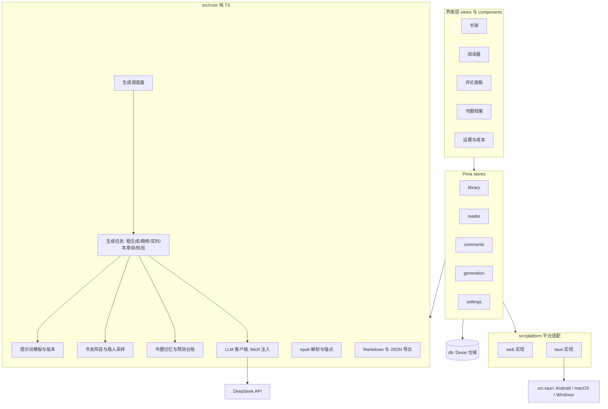
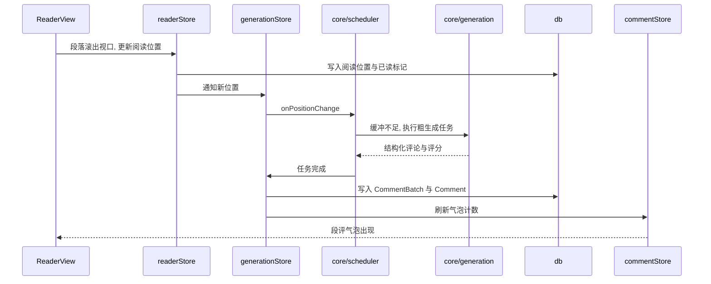

# 书友席 技术方案与实现计划

- 版本：0.1
- 日期：2026 年 11 月
- 对应产品文档：[产品设计_V2.md](产品设计_V2.md)（下文简称「产品文档」，引用时写作「产品 §x」）
- 用途：后续开发按本文档的模块划分、接口约定和任务编号推进。实现中如果偏离本文档，先改文档，再改代码。

---

## 0. 概述

书友席是一个纯客户端 App：

- **外壳**：Tauri 2，一套代码打包 Android、macOS、Windows 三端。
- **界面**：Vue 3 + TypeScript + Vant 4。阅读器正文和段评气泡自己实现。
- **数据**：全部存在本地，结构化数据用 Dexie（IndexedDB），书籍原文件存在 App 数据目录。
- **模型**：默认 DeepSeek，客户端直连，没有任何后端服务。
- **开发方式**：日常在浏览器里开发调试同一套 Web 代码，需要验证原生能力时再跑桌面端或 Android 真机。

---

## 1. 技术选型

### 1.1 已确认的前提

| 前提 | 结论 |
| --- | --- |
| 形态 | 纯客户端 App，无后端，无静态托管 |
| 目标平台 | Android（主要阅读设备）、macOS、Windows |
| 框架 | Vue 3 + TypeScript |
| 默认模型 | DeepSeek `deepseek-chat`，模型名和接口地址可配置，走 OpenAI 兼容接口 |
| 跨域 | 已实测 `api.deepseek.com` 的跨域预检返回 200，允许 `authorization` 请求头，浏览器开发模式可以直连 |

### 1.2 选型清单

| 层 | 选择 | 理由 |
| --- | --- | --- |
| 外壳 | Tauri 2 | 一套外壳覆盖三端；安装包约 10 到 20 MB；官方插件覆盖所需原生能力 |
| 构建 | pnpm、Vite、TypeScript strict | 与现有项目习惯一致，Tauri 官方推荐组合 |
| 代码规范 | ESLint flat config、Prettier | |
| 界面框架 | Vue 3.5、Vue Router 4、Pinia | |
| 组件库 | Vant 4 | 移动端底部抽屉、弹层、表单、Toast 现成可用；桌面端靠响应式布局适配 |
| 样式 | Less、CSS 变量 | 阅读主题（日间、护眼、夜间）用 CSS 变量切换 |
| EPUB 解析 | JSZip、DOMParser | 自己解析 OPF、nav 与 NCX 目录，完全控制段落结构 |
| 内容清洗 | DOMPurify | 章节 XHTML 渲染前清洗，去掉脚本和危险属性 |
| 本地数据库 | Dexie 4 | 浏览器与 Tauri WebView 通用，开发模式和 App 共用一套存储代码 |
| 数据校验 | zod | 校验模型返回的 JSON；同时作为领域类型来源 |
| 流式解析 | eventsource-parser | 解析 OpenAI 兼容接口的 SSE 流 |
| 单元测试 | Vitest、fake-indexeddb | 覆盖 `src/core` 和 `src/db` |
| 脚本运行 | tsx | 运行阶段 0 的生成脚本，直接复用 `src/core` |

**Tauri 插件**

| 插件 | 用途 |
| --- | --- |
| `@tauri-apps/plugin-http` | 原生 HTTP，不受跨域限制；用于 App 内的模型调用 |
| `@tauri-apps/plugin-fs` | 书籍原文件存取、导出文件写入 |
| `@tauri-apps/plugin-dialog` | 选择要导入的书、选择导出位置 |
| `@tauri-apps/plugin-store` | 保存 API Key 和模型配置 |
| `@tauri-apps/plugin-os` | 识别当前平台（Android 或桌面） |

### 1.3 选型记录：为什么不用 React Native

| 维度 | React Native | Tauri 2 |
| --- | --- | --- |
| EPUB 正文渲染 | 没有 DOM，要么转成原生组件丢失 CSS 排版，要么放进 WebView | DOM 和 CSS 原生支持，排版还原度高 |
| 划线批注 | 原生 Text 不支持自定义选区 | 浏览器 Selection API 直接可用 |
| 桌面端 | 依赖微软维护的 Windows、macOS 两个独立分支，版本滞后，Expo 不支持 | 桌面是主场 |
| 流式输出 | 内置 fetch 不支持流，需要额外的库 | 直接可用 |
| 阶段 0 原型与 Web 版 | 需要先搭起 App | 同一套代码就是网页 |

React Native 的优势是低端 Android 机上的长列表滚动更顺。但名著按章加载，一章的段落量 WebView 能够承受，这一点不足以抵消正文渲染和划线批注上的硬伤。

### 1.4 已知的技术风险

| 风险 | 应对 |
| --- | --- |
| `plugin-http` 的流式响应在 Android 上表现不确定 | M0 已在浏览器与桌面端验证 JSON + SSE 流式通路；**Android 真机流式表现待连设备后补验**。如有问题，App 内的流式调用改用 WebView 原生 fetch，因为 DeepSeek 允许跨域 |
| Android WebView 渲染长章节卡顿 | 段落容器使用 `content-visibility: auto`；章节过长时分段渐进渲染 |
| 国内 EPUB 结构混乱（整章一个 `div`、用 `br` 分段等） | 段落抽取做多种兜底规则，导入后提供段落预览 |
| DeepSeek 输出长度上限 | 默认最多输出 4K tokens，可以调到 8K。粗生成一块的输出控制在约 1500 tokens，精修约 1200 tokens，都远低于上限 |
| JSON mode 偶发返回空内容 | 校验失败视为一次失败，进入重试；提示词里必须出现「json」字样，这是 JSON mode 的要求 |
| Android WebView 中输入法与底部抽屉的遮挡 | 评论输入框跟随可视区域高度变化调整位置，M4 在真机上专门验收 |

---

## 2. 架构

### 2.1 分层原则

1. **`src/core` 是纯 TypeScript**：不依赖 Vue、Dexie 或 Tauri。生成逻辑写成「输入上下文，输出结构化结果」的函数，持久化交给上层。这样阶段 0 的 Node 脚本可以直接复用，单元测试也不需要模拟界面。
2. **原生能力只经由 `src/platform`**：业务代码里不直接 import 任何 `@tauri-apps/*` 包，浏览器模式因此始终可以运行。
3. **`src/stores` 负责编排**：把 core 的计算、db 的读写、platform 的能力串起来，供界面使用。

### 2.2 架构图



### 2.3 一次阅读中的数据流



---

## 3. 目录结构与模块拆分

### 3.1 目录结构

```
reader-seat/
  docs/                    产品与技术文档
  src/
    core/
      types.ts             领域类型（由 zod schema 推导）
      epub/                unzip、opf、toc、段落抽取、清洗、锚点
      llm/                 client、sse、jsonl 解析、重试、计费
      prompts/             rough、refine、live、chapterTalk、spoilerCheck、禁用套话表、PROMPT_VERSION
      generation/          各生成任务、zod schema、剧透实体规则校验
      scheduler/           阅读缓冲窗口、优先级队列、暂停与恢复
      personas/            默认五位常驻书友、出场选择规则、路人采样
      memory/              BookMemory 操作、预测台账、章节摘要合并
      export/              Markdown 导出、JSON 全量备份与恢复
    platform/
      index.ts             运行时检测，导出 platform 单例
      types.ts             Platform 接口
      web.ts               浏览器实现
      tauri.ts             Tauri 实现
    db/
      schema.ts            Dexie 数据库定义
      repos/               各对象的仓储函数
    stores/                library、reader、comments、generation、settings
    views/                 LibraryView、BookSetupView、ReaderView、ArchiveView、SettingsView、Phase0View
    components/
      reader/              ChapterContent、ParagraphBubble、CommentPanel、ThreadItem、Composer、DanmakuStrip、ChapterTalk
      common/              通用小组件
    styles/                主题变量、阅读排版
    router.ts
    main.ts
  src-tauri/               Rust 外壳：插件注册、capabilities 权限、图标、Android 与桌面打包配置
  scripts/
    phase0-generate.ts     阶段 0：对本地文本片段生成评论 fixture
  fixtures/                本地样本与生成结果（gitignore，原文不入库）
  tests/                   与 src 结构对应的单元测试
```

### 3.2 模块说明

下表列出每个模块的职责、对外接口和对应的产品章节。接口是约定的主要函数签名，实现时可以补充，但不能改变语义；如需改变，先更新本文档。

#### core/types

- **职责**：集中定义领域类型，包括 Book、Chapter、Paragraph、Comment、ResidentReader、BookMemory、Prediction 等，字段与产品 §12 一致。
- **约定**：模型输出相关的类型由 `generation` 里的 zod schema 推导（`z.infer`），避免两处定义不一致。

#### core/epub

- **职责**：把 EPUB 字节解析成书籍元数据、章节和段落；生成段落锚点。
- **对应**：产品 §11「书籍导入」「段落锚定」，产品 §13.2；AC-01。

```ts
interface ParsedBook {
  meta: { title: string; author?: string; translator?: string; fingerprint: string }
  chapters: ParsedChapter[]
}
interface ParsedChapter {
  href: string
  order: number
  title: string
  paragraphs: { index: number; text: string; html: string; anchor: string }[]
}
function parseEpub(bytes: Uint8Array): Promise<ParsedBook>
function makeAnchor(href: string, index: number, text: string): string
function extractParagraphs(xhtml: string): { text: string; html: string }[]
```

#### core/llm

- **职责**：OpenAI 兼容接口客户端，支持三种调用方式：一次性 JSON、SSE 文本流、每行一个 JSON 的流；内置重试和用量统计。
- **依赖**：只依赖注入进来的 `fetch`，不感知运行在浏览器、Tauri 还是 Node。
- **对应**：产品 §7.5、§13.1、§14。

```ts
interface LlmConfig { baseUrl: string; apiKey: string; model: string; fetch: typeof fetch }
interface LlmUsage { promptTokens: number; completionTokens: number; cacheHitTokens: number }
interface LlmClient {
  chatJson<T>(messages: ChatMessage[], schema: ZodType<T>, opts?: CallOptions): Promise<{ data: T; usage: LlmUsage }>
  chatStream(messages: ChatMessage[], onDelta: (text: string) => void, opts?: CallOptions): Promise<LlmUsage>
  chatJsonl<T>(messages: ChatMessage[], schema: ZodType<T>, onItem: (item: T) => void, opts?: CallOptions): Promise<LlmUsage>
}
function createLlmClient(config: LlmConfig): LlmClient
function estimateCost(usage: LlmUsage, pricing: Pricing): number
```

#### core/prompts

- **职责**：各类生成任务的提示词模板、通用约束、禁用套话表，以及 `PROMPT_VERSION`。
- **约定**：
  - 所有模板按「固定系统提示、书友设定、书圈记忆、当前块文本」的顺序拼接，让请求前缀尽量稳定，提高 DeepSeek 前缀缓存的命中率。
  - 任何改动提示词的提交都要递增 `PROMPT_VERSION`。
- **对应**：产品 §15。

```ts
const PROMPT_VERSION: number
function buildRoughPrompt(ctx: RoughContext): ChatMessage[]
function buildRefinePrompt(ctx: RefineContext): ChatMessage[]
function buildLivePrompt(ctx: LiveContext): ChatMessage[]
function buildChapterTalkPrompt(ctx: ChapterTalkContext): ChatMessage[]
function buildSpoilerCheckPrompt(ctx: SpoilerCheckContext): ChatMessage[]
```

#### core/generation

- **职责**：执行各生成任务，包括调用 LLM、zod 校验、剧透规则过滤，最后返回可以直接落库的结构化结果。本模块不读写数据库。
- **对应**：产品 §7、§9、§15；AC-03、04、05、07、08。

```ts
function runRough(ctx: RoughContext, client: LlmClient): Promise<RoughResult>
function runRefine(ctx: RefineContext, client: LlmClient): Promise<RefineResult>
function runLiveReply(ctx: LiveContext, client: LlmClient, onReply: (r: LiveReply) => void): Promise<LiveResult>
function runChapterTalk(ctx: ChapterTalkContext, client: LlmClient): Promise<ChapterTalkResult>
function runSpoilerCheck(ctx: SpoilerCheckContext, client: LlmClient): Promise<SpoilerCheckResult>
function filterByEntityRule(comments: GeneratedComment[], block: BlockText, knownEntities: Set<string>): GeneratedComment[]
```

#### core/scheduler

- **职责**：根据阅读位置维护前方缓冲；管理粗生成、精修、实时三类任务的优先级队列和并发数；支持暂停与恢复。
- **约定**：调度器只决定何时执行什么任务，任务的具体执行通过回调交给上层。
- **对应**：产品 §7.2；AC-03、04。

```ts
type TaskKind = 'live' | 'rough' | 'refine' | 'chapterTalk' | 'spoilerCheck'
interface SchedulerDeps {
  getBufferedAhead(pos: ReadingPosition): Promise<number>
  planNextBlock(pos: ReadingPosition): Promise<BlockPlan | null>
  execute(task: Task): Promise<TaskOutcome>
}
interface Scheduler {
  onPositionChange(pos: ReadingPosition): void
  enqueue(task: Task): void
  pause(): void
  resume(): void
  onTaskDone(listener: (task: Task, outcome: TaskOutcome) => void): () => void
}
function createScheduler(deps: SchedulerDeps, opts?: { refineConcurrency?: number; bufferLow?: number }): Scheduler
```

#### core/personas

- **职责**：定义默认五位常驻书友（头回读、课代表、考据癖、毒舌、老书虫）的固定设定；决定每段由哪些常驻书友出场；为路人采样。
- **对应**：产品 §4。

```ts
const DEFAULT_LINEUP: ResidentPersona[]
function pickResidents(ctx: { score: number; reasons: string[] }, lineup: ResidentPersona[], spoilerLevel: SpoilerLevel): ResidentPersona[]
function samplePassersby(seed: string, count: number): PasserbyProfile[]
function pickRepliers(userText: string, paragraphComments: Comment[], lineup: ResidentPersona[], mention?: string): ResidentPersona[]
```

#### core/memory

- **职责**：书圈记忆的纯函数操作，包括应用模型返回的记忆更新、预测台账状态流转、章末摘要合并与去重，以及为提示词生成精简的记忆快照。
- **对应**：产品 §5；AC-06。

```ts
function applyMemoryUpdates(memory: BookMemory, updates: MemoryUpdates): BookMemory
function resolvePredictions(predictions: Prediction[], hits: PredictionHit[], at: string): Prediction[]
function mergeChapterSummary(memory: BookMemory, chapterId: string, summary: string): BookMemory
function snapshotForPrompt(memory: BookMemory, predictions: Prediction[], budgetChars: number): MemorySnapshot
```

#### core/export

- **职责**：把批注、段评和微评导出为 Markdown（格式见产品 §10.3）；完成 JSON 全量备份与恢复。
- **对应**：产品 §10.3、§11；AC-12。

```ts
function exportBookMarkdown(input: ExportInput): string
function buildBackup(tables: Record<string, unknown[]>, meta: BackupMeta): string
function parseBackup(json: string): { meta: BackupMeta; tables: Record<string, unknown[]> }
```

#### platform

- **职责**：屏蔽浏览器与 Tauri 的差异，提供文件、网络、密钥、常亮四类原生能力。
- **约定**：
  - `index.ts` 在启动时检测运行环境（是否存在 Tauri 运行时），导出 `platform` 单例。
  - 其余代码只依赖 `Platform` 接口。

```ts
interface Platform {
  kind: 'web' | 'android' | 'desktop'
  fetch: typeof fetch
  pickBookFile(): Promise<{ name: string; bytes: Uint8Array } | null>
  saveBookFile(bookId: string, bytes: Uint8Array): Promise<void>
  readBookFile(bookId: string): Promise<Uint8Array>
  deleteBookFile(bookId: string): Promise<void>
  exportTextFile(fileName: string, content: string): Promise<void>
  getSecret(key: string): Promise<string | null>
  setSecret(key: string, value: string): Promise<void>
  keepAwake(on: boolean): Promise<void>
}
```

| 能力 | web 实现 | tauri 实现 |
| --- | --- | --- |
| fetch | 原生 `fetch` | `plugin-http` 的 `fetch`（流式不稳定时回退为原生 fetch） |
| 选书 | `<input type="file">` | `plugin-dialog` 选择文件，`plugin-fs` 读取 |
| 书籍文件存取 | Dexie 的 `bookFiles` 表（Blob） | `plugin-fs` 读写 App 数据目录下的 `books/{bookId}.epub` |
| 导出文件 | 触发浏览器下载 | 桌面用 `plugin-dialog` 选择保存位置；Android 写入下载目录 |
| 密钥 | Dexie 的 `settings` 表 | `plugin-store` |
| 常亮 | Screen Wake Lock API | 优先 Wake Lock API；不支持时在 M5 补原生实现 |

#### db

- **职责**：Dexie 数据库定义和仓储函数。仓储函数是界面层读写数据的唯一入口，不在组件里直接写 Dexie 查询。
- **对应**：产品 §12。表结构见 4.6。

#### stores

| store | 职责 |
| --- | --- |
| settings | 模型配置（地址、模型名、API Key）、阅读主题与字体、连通性测试 |
| library | 书架列表、导入流程（选书、解析、落库、存文件）、删除书籍 |
| reader | 当前书和章节、阅读位置、已读标记、章节切换 |
| generation | 持有调度器实例；实现调度器的回调（组装上下文、调用 core、落库）；记录 GenerationLog |
| comments | 按段落读取评论、气泡计数、发段评与回复（触发实时任务）、反馈标记 |

#### views 与 components

| 界面 | 内容 | 对应 |
| --- | --- | --- |
| LibraryView | 书架、导入、删除 | AC-01、12 |
| BookSetupView | 书友阵容、防剧透档位、先写后看模式、所属阅读计划站点 | 产品 §4.2、§9、§10 |
| ReaderView | 章节正文、目录、阅读设置、气泡、评论面板 | 产品 §6.2；AC-02、03 |
| ChapterContent | 渲染清洗后的章节 HTML，为每段挂锚点和 IntersectionObserver | AC-02 |
| ParagraphBubble | 段末气泡：数字、热段样式、锁定状态 | 产品 §6.2 |
| CommentPanel | 手机底部抽屉，桌面右侧栏；AI 标注、排序、楼中楼折叠 | AC-10 |
| ThreadItem、Composer | 单条评论与回复；段评输入、@ 书友、流式显示 | AC-07 |
| ArchiveView | 书圈档案：外号、名场面、预测台账（M5） | 产品 §5.4 |
| SettingsView | 模型配置、成本面板、备份与恢复 | AC-12 |
| Phase0View | 阶段 0 原型：读取 fixture 渲染气泡与面板、质量标注 | 产品 §16 |

---

## 4. 关键技术设计

### 4.1 段落抽取与锚点

**抽取规则**（`extractParagraphs`）：

1. 以块级元素为段落单位：`p`、`h1` 到 `h6`、`blockquote`、`li`、`pre`，以及只含文本或行内元素的 `div`。
2. 兜底：如果一个块级元素里用连续的 `br` 分隔内容，按 `br` 拆成多段。
3. 丢弃纯空白段落，图片只作为相邻段落的附属内容保留，不单独成段。
4. 标题段落参与编号，但生成时默认评分为 0。
5. 段落的 `text` 用于生成和哈希；`html` 是清洗后的片段，用于渲染。

**锚点**：`{chapterHref}#{index}:{hash8}`

- `hash8` 为段落纯文本（去除空白后）的 FNV-1a 32 位哈希，取 8 位十六进制字符，同步计算。
- 书籍指纹 `fingerprint` 是 EPUB 文件字节的 SHA-256，用 `crypto.subtle` 计算，在 WebView 和 Node 20 中都可用。
- 重新导入同一指纹的书时，直接复用原有数据；指纹不同但书名相同时，按锚点逐段比对，哈希对不上的段落，其评论标为「失配」，不再显示。

### 4.2 阅读位置与已读判定

- **阅读位置**：`{ chapterId, paragraphIndex, offsetRatio }`，其中 `offsetRatio` 是视口顶部在该段内的相对位置。恢复时先滚到该段，再按比例微调。
- **已读判定**：每个段落挂一个 IntersectionObserver，段落底部越过视口顶部即记为已读。
- **持久化**：每章只记录 `readUpTo`（已读到的最大段落序号），写入时节流到每 2 秒一次。
- **章节读完**：`readUpTo` 达到本章最后一段时，触发章末任务：本章摘要、记忆整理，阶段 2 起还有本章说。
- **评论面板**：打开和关闭面板都不触发滚动。手机上用底部抽屉覆盖下半屏，桌面上用侧栏，正文容器宽度保持不变，满足 AC-02。

### 4.3 分块规则（`planNextBlock`）

- 从阅读位置之后第一个未生成的段落开始累积。
- 累积到 1500 字或 15 段时结束；单块最多 3000 字，超过就提前截断。
- 块不跨章节。
- 块内段落按 `p1` 到 `pn` 编号发给模型，结果按编号映射回段落锚点。

### 4.4 调度器

| 参数 | 默认值 | 说明 |
| --- | --- | --- |
| `bufferLow` | 8 段 | 前方已生成的段落少于这个数时，规划下一块 |
| `bufferTarget` | 15 段 | 补到这个数为止 |
| 粗生成并发 | 1 | 保证块按顺序生成 |
| 精修并发 | 2 | |
| 实时任务 | 单独预留 1 个并发槽 | 不会被后台任务堵住 |

**优先级**（数字越小越先执行）：实时 0、粗生成 1、精修 2、本章说与记忆整理 3、剧透二次校验 4。同类任务里，离阅读位置越近越优先。

**其他规则**

- 去重：任务以「类型 + 段落或块的标识」为键，同一个键不重复入队。
- 跳读：阅读位置一次跳过两块以上时，清掉队列里尚未开始的粗生成和精修任务，从新位置重建缓冲；已在执行的任务允许完成。
- 暂停：`document.visibilityState` 变为 `hidden` 时暂停派发新任务，回到前台时恢复。
- 重启恢复：任务队列不持久化。启动后根据 `Paragraph.genStatus` 和阅读位置重新规划。

**段落生成状态** `genStatus`：`none`、`rough`（已粗生成）、`refining`、`refined`、`failed`。

### 4.5 生成上下文的组装

由 `generationStore` 负责从数据库读取并组装，`core/generation` 只接收组装好的上下文。

| 上下文 | 来源 | 长度控制 |
| --- | --- | --- |
| 书籍信息与防剧透档位 | Book | 固定 |
| 常驻书友设定 | ResidentReader | 粗生成只发精简版（职能、两句口吻样本、当前站队）；精修发完整版 |
| 记忆快照 | BookMemory、Prediction，经 `snapshotForPrompt` 生成 | 约 1500 字以内；外号表、待验证预测优先保留 |
| 前文摘要 | Chapter.summary | 最近 3 章保留全文摘要，更早的章节合并成一段总摘要 |
| 当前块文本 | Paragraph | 见 4.3 |
| 已出现实体表 | BookMemory 中累积的实体 | 只发名字列表 |
| 用户口味示例 | 用户标记过的段落 | 最多 3 个正例和 3 个反例，只发前 50 字 |

拼接顺序固定为：系统提示、书友设定、记忆快照、前文摘要、当前块。越靠前的部分越稳定，越容易命中 DeepSeek 的前缀缓存。

### 4.6 剧透防线

| 防线 | 实现位置 | 做法 |
| --- | --- | --- |
| 只发已读与当前块 | generationStore 组装上下文 | 前文摘要只包含 `readUpTo` 已覆盖的章节；不发序言、译者前言、内容简介 |
| 块内段落约束 | prompts | 明确要求评论 `pi` 只能使用 `p1` 到 `pi` 的内容 |
| 实体规则校验 | `filterByEntityRule` | 对模型返回的 `new_entities` 加上已知实体表，计算每个实体在块内首次出现的段落；第 i 段的评论里出现了首次出现位置大于 i 的实体，就丢弃这条评论 |
| 自报字段 | zod schema | `uses_outside_plot` 为 true 的评论丢弃 |
| 档位约束 | prompts、personas | 严格档下老书虫不出场；「可暗示」档的提示词附「重要性 / 方向」的正反例 |
| 二次校验（M5） | `runSpoilerCheck` | 热段精修后单独调用一次，温度为 0，不通过的评论丢弃 |
| 用户反馈 | comments store | 被标记剧透的评论隐藏，并作为反例进入之后的提示词 |

### 4.7 LLM 调用细节

| 任务 | 调用方式 | 温度 | 最大输出 | 超时 |
| --- | --- | --- | --- | --- |
| 粗生成 | `chatJson`，`response_format: json_object` | 1.0（需要评分稳定） | 2000 | 60 秒 |
| 热段精修 | `chatJson` | 1.3 | 2000 | 60 秒 |
| 实时回复 | `chatJsonl`，流式 | 1.3 | 800 | 首个 token 15 秒 |
| 本章说与记忆整理 | `chatJson` | 1.0 | 2000 | 60 秒 |
| 剧透校验 | `chatJson` | 0 | 800 | 30 秒 |

- **每行一个 JSON 的流**：把 SSE 增量拼接进缓冲区，遇到换行就取出完整的一行做 zod 校验，通过就立即回调渲染，不合格的行丢弃。
- **重试**：网络错误、429、5xx，以及 zod 校验失败时，等待 2 秒后重试 1 次；仍失败则记为失败。
- **取消**：每个任务持有自己的 AbortController，调度器清理队列或页面卸载时中止请求。
- **用量**：读取响应中的 `usage`，包括 `prompt_cache_hit_tokens` 和 `prompt_cache_miss_tokens`，写入 GenerationLog。
- **计价**：单价在设置里配置（缓存命中输入、未命中输入、输出，每百万 tokens 的价格），因为价格会变，不写死在代码里。

### 4.8 Dexie 表结构

```ts
db.version(1).stores({
  books: 'id, fingerprint, title, updatedAt',
  chapters: 'id, bookId, [bookId+order]',
  paragraphs: 'id, bookId, chapterId, [chapterId+order], genStatus',
  residentReaders: 'id, bookId',
  bookMemories: 'bookId',
  predictions: 'id, bookId, status',
  commentBatches: 'id, paragraphId, [paragraphId+batchNo]',
  comments: 'id, batchId, paragraphId, parentId, authorType',
  userNotes: 'id, bookId, paragraphId, type',
  chapterTalks: 'id, chapterId',
  readingStates: 'bookId',
  generationLogs: 'id, bookId, type, createdAt',
  settings: 'key',
  bookFiles: 'bookId', // 仅浏览器模式使用
})
```

- 字段定义与产品 §12 一致，另外新增 `readingStates`，保存阅读位置和每章的 `readUpTo`。
- 以后的结构变更一律通过 `db.version(n).upgrade()` 迁移，不允许直接修改已发布版本的定义。

### 4.9 平台能力与权限范围

`src-tauri/capabilities/default.json` 的权限原则：

- **HTTP**：只放行 `https://api.deepseek.com/*`，以及构建时预置的少量备选模型地址。
  - Tauri 的 HTTP 放行范围在构建时确定。如果要接入新的模型服务商，又不想重新打包，可以在设置里打开「使用 WebView 原生请求」，前提是对方允许跨域。
- **文件系统**：只放行 App 数据目录 `$APPDATA/**`；导出时额外放行下载目录 `$DOWNLOAD/**`。
- **对话框、store、os**：使用默认权限。

### 4.10 失败处理

| 失败场景 | 用户可见表现 | 系统行为 |
| --- | --- | --- |
| 粗生成失败 | 对应段落不显示气泡 | 重试 1 次；仍失败则标记 `failed`，用户下次点这段的「这里有意思」或重新进入章节时再试 |
| 精修失败 | 保留粗生成的评论 | 重试 1 次，`genStatus` 回到 `rough` |
| 实时回复失败 | 面板里显示「书友没接上话」和重试按钮 | 已流式显示的部分保留 |
| 未配置 API Key 或 Key 无效 | 阅读正常；书架页顶部提示去设置 | 调度器不启动 |
| 离线 | 已缓存的评论照常显示 | 调度器暂停，网络恢复后继续 |
| EPUB 解析失败 | 导入时提示具体原因 | 不写入任何数据 |

所有模型调用（成功或失败）都写一条 GenerationLog，包含类型、tokens、费用、耗时和错误信息。

### 4.11 备份与恢复

- 备份内容是除 `bookFiles` 以外的全部表，导出为一个 JSON 文件，包含 schema 版本号和导出时间。
- 书籍原文件不进备份，避免文件过大。恢复后，书架里的书显示为「需要重新导入文件」；重新导入同一指纹的 EPUB 后自动关联，评论、记忆和批注全部保留。
- 恢复前提示会覆盖当前数据。

---

## 5. 实现计划

### 5.1 里程碑总览

| 里程碑 | 目标 | 粗略工期 | 完成标志 |
| --- | --- | --- | --- |
| M0 工程脚手架 | 三端都能跑起来，模型能调通 | 约 1 周 | 浏览器、桌面、Android 真机均可启动；设置页连通性测试通过 |
| M1 阶段 0 原型 | 验证「明知是 AI，评论区还有没有氛围」 | 1 到 2 周 | 通过产品 §16 阶段 0 的关卡 |
| M2 阅读器基础 | 能导入 EPUB 并舒服地读 | 约 1.5 周 | AC-01、AC-02 |
| M3 生成管线 | 读到哪里，评论就已经在哪里 | 约 2 周 | AC-03、04、05、08、09、10、11 |
| M4 互动与记忆 | 能参与、书友有记忆，MVP 完成 | 约 2 周 | AC-06、07、12；三端安装包 |
| M5 阶段 2 | 接入阅读计划的输出流程 | 约 3 周 | 产品 §11 全部 Should 项 |
| M6 Later | 长期扩展 | 不定 | 按需推进 |

工期是粗略估计，实际以完成标志为准，不以时间为准。M1 的关卡不通过时，先回到提示词和书友设定上迭代，不进入 M2。

### 5.2 M0 工程脚手架

| 编号 | 任务 | 交付物 | 验收 |
| --- | --- | --- | --- |
| M0-1 | 安装工具链 | Rust（rustup，stable）；Xcode 命令行工具；Android Studio，及其中的 SDK、NDK、JDK 17；配置 `JAVA_HOME`、`ANDROID_HOME`、`NDK_HOME`；执行 `rustup target add aarch64-linux-android armv7-linux-androideabi i686-linux-android x86_64-linux-android` | `pnpm tauri info` 无报错 |
| M0-2 | 初始化前端工程 | 在仓库根目录用 Vite 的 vue-ts 模板初始化；接入 Vue Router、Pinia、Less；Vant 按需引入（unplugin-vue-components 加 `@vant/auto-import-resolver`）；`@` 路径别名；ESLint、Prettier、Vitest；`.gitignore`（含 `fixtures/`、`src-tauri/target/`、`src-tauri/gen/`、`.env.local`）；`git init` | `pnpm dev`、`pnpm lint`、`pnpm test` 均可运行 |
| M0-3 | 接入 Tauri 2 | `pnpm tauri init`；安装 http、fs、dialog、store、os 插件（前端包和 Rust crate）；编写 capabilities（见 4.9）；`pnpm tauri android init`；Vite 配置支持 `TAURI_DEV_HOST`，让真机访问开发服务器 | `pnpm tauri dev` 打开桌面窗口；`pnpm tauri android dev` 在 USB 连接的真机上打开 |
| M0-4 | 平台适配层骨架 | `src/platform` 的接口、运行时检测、web 与 tauri 两套实现（本阶段实现 fetch、getSecret、setSecret，其余方法先抛「未实现」） | 浏览器和 App 内都能读写密钥 |
| M0-5 | 数据库骨架 | `src/db/schema.ts`（见 4.8）、settings 仓储 | fake-indexeddb 下的仓储单元测试通过 |
| M0-6 | LLM 客户端与设置页 | `core/llm` 的 `chatJson`、`chatStream`；SettingsView 可填写接口地址、模型名、API Key，提供「测试连接」按钮 | 三端都能完成一次 JSON 调用和一次流式调用；把 `plugin-http` 在 Android 上的流式表现写回本文档 1.4 节 |

### 5.3 M1 阶段 0 原型

| 编号 | 任务 | 交付物 | 验收 |
| --- | --- | --- | --- |
| M1-1 | 领域类型与输出 schema | `core/types.ts`；粗生成、精修的 zod schema（字段见产品 §15.2、§15.3） | 用样例 JSON 跑通 schema 的单元测试 |
| M1-2 | 默认书友阵容 | `core/personas` 的 `DEFAULT_LINEUP`（五位，含口吻样本、关注点、禁区、关系）和 `samplePassersby` | 单元测试：同一个 seed 采样结果稳定，同一段内路人互不重复 |
| M1-3 | 提示词 v1 | `core/prompts` 的粗生成与精修模板、通用约束、禁用套话表，`PROMPT_VERSION = 1` | 提示词快照测试 |
| M1-4 | 生成任务 | `runRough`、`runRefine`、`filterByEntityRule`；`core/memory` 的最小版 `applyMemoryUpdates`（外号、预测） | 实体规则的单元测试覆盖「后文实体」「已知实体」「无实体」三种情况 |
| M1-5 | 阶段 0 生成脚本 | `scripts/phase0-generate.ts`：读入 `fixtures/phase0/source.txt`（约 1 万字，空行分段），按块依次粗生成、精修，并在块之间传递记忆，输出 `fixtures/phase0/comments.json`；API Key 从 `.env.local` 读取 | `pnpm phase0` 跑完全部文本，输出通过 schema 校验，控制台打印用量和费用 |
| M1-6 | 原型阅读页 | Phase0View：渲染原文、段评气泡、评论面板（Vant 底部弹层）、楼中楼、AI 标注；每条评论可以标「有趣 / 无聊 / 剧透 / 错误」，标注存在本地，可以导出为 JSON | 手机上阅读流畅，打开、关闭面板不跳位置 |
| M1-7 | 装到手机 | `pnpm tauri android build --apk`，生成并保存好签名密钥库（见第 8 节） | APK 装到自己的 Android 手机上并能打开原型 |
| M1-8 | 关卡评估 | 连续 3 个阅读日使用，导出标注数据，在本文档末尾记录结论 | 产品 §16 的通过条件：连续 3 天主动点开气泡；热段评论中「有趣」占一半以上 |

### 5.4 M2 阅读器基础

| 编号 | 任务 | 交付物 | 验收 |
| --- | --- | --- | --- |
| M2-1 | EPUB 解析 | `core/epub`：OPF、nav/NCX、章节顺序、段落抽取（规则见 4.1）、锚点、指纹 | 单元测试：用代码生成的最小 EPUB 样本，覆盖 `p` 分段、`br` 分段、空段落、嵌套 `div` |
| M2-2 | 导入流程 | library store：选书、解析、写库、保存原文件；同指纹去重；platform 的 `pickBookFile`、`saveBookFile`、`readBookFile` 完整实现 | AC-01：导入 2 到 3 本真实的中文名著 EPUB，章节和段落正确 |
| M2-3 | 书架 | LibraryView：封面占位、书名、阅读进度、删除入口 | |
| M2-4 | 开书设置 | BookSetupView：书友阵容开关、防剧透档位、先写后看模式（本阶段只保存设置，M5 生效）、所属阅读计划站点 | 设置能保存，重新进入能看到 |
| M2-5 | 阅读器 | ReaderView 与 ChapterContent：渲染清洗后的章节 HTML、目录、上下章切换；长章节使用 `content-visibility: auto` | Android 真机上一章 2 万字以上的章节滚动不卡顿 |
| M2-6 | 阅读设置 | 字号、行距、主题（日间、护眼、夜间） | 设置即时生效并持久化 |
| M2-7 | 阅读位置与已读 | IntersectionObserver、`readingStates`、位置恢复（见 4.2） | AC-02 |
| M2-8 | 桌面布局 | 宽屏下正文居中限宽，为右侧评论栏预留位置 | 桌面窗口缩放时布局正常 |

### 5.5 M3 生成管线

| 编号 | 任务 | 交付物 | 验收 |
| --- | --- | --- | --- |
| M3-1 | 调度器 | `core/scheduler`（规则见 4.4） | 单元测试（fake timers）：缓冲补齐、优先级、去重、跳读清队、暂停恢复 |
| M3-2 | 生成编排 | generation store：`planNextBlock`、上下文组装（见 4.5）、执行粗生成与精修、落库、写 GenerationLog | 顺序阅读一整章，每段在读到之前都已有生成结果 |
| M3-3 | 剧透防线接入 | 实体规则、自报字段、档位约束全部接入；严格档下老书虫不出场 | AC-08：人工检查一章的评论，没有当前段之后的情节 |
| M3-4 | 段评气泡 | ParagraphBubble：真实计数、热段样式；comments store 的计数查询 | |
| M3-5 | 评论面板（只读） | CommentPanel 与 ThreadItem：手机底部抽屉、桌面右侧栏、AI 标注、排序、楼中楼折叠 | AC-05、AC-10 |
| M3-6 | 缓存与批次 | CommentBatch 的批次语义，重开同一段显示同一批 | AC-09 |
| M3-7 | 跳读补生成 | 跳到未生成的位置时，当前段以实时优先级生成，并从新位置重建缓冲 | AC-03、AC-04 |
| M3-8 | 失败与无 Key 状态 | 失败处理（见 4.10）、未配置 Key 时的提示、离线暂停 | AC-11：断网和填错 Key 时阅读不受影响 |

### 5.6 M4 互动与记忆（MVP）

| 编号 | 任务 | 交付物 | 验收 |
| --- | --- | --- | --- |
| M4-1 | 我的段评与实时回复 | Composer；`core/llm` 的 `chatJsonl`；`runLiveReply`；`pickRepliers`；@ 常驻书友；流式渲染 | AC-07：2 秒内开始出现回复，内容针对段评本身 |
| M4-2 | 回复线程 | 回复任意评论，线程内多轮对话，被回复的书友延续口吻 | |
| M4-3 | 书圈记忆 | `core/memory` 完整版：外号、名场面、预测台账、争议、书友状态、实体累积；`snapshotForPrompt` | AC-06：读完三章后，后文能引用前面的外号或回收预测 |
| M4-4 | 章末整理 | 章节读完后生成本章摘要并整理记忆（使用 `runChapterTalk`，本阶段只用摘要和记忆字段，本章说界面放在 M5） | 摘要只包含已读内容 |
| M4-5 | 评论反馈 | 收藏、无聊、剧透、错误四种标记；被标剧透的隐藏；正反例进入提示词 | |
| M4-6 | 数据删除与备份 | 删除一本书的全部数据和原文件；JSON 全量备份与恢复（见 4.11） | AC-12；备份后清空数据再恢复，重新导入 EPUB 后数据完整 |
| M4-7 | 三端打包 | Android 正式签名 APK；macOS 的 dmg；`.github/workflows/release.yml` 用 tauri-action 构建 Windows 安装包 | 三个安装包都能安装运行 |
| M4-8 | MVP 验收 | 在 Android 和 macOS 上逐条走一遍 AC-01 到 AC-12，结果记录在本文档末尾 | 全部通过 |

### 5.7 M5 阶段 2

| 编号 | 任务 | 对应产品章节 |
| --- | --- | --- |
| M5-1 | 本章说界面：热段、书友一句话、争议汇总、预测更新、微评入口与书友回应 | §8 |
| M5-2 | 先写后看：逐段先写后看、章末解锁、带评论二刷 | §10.2 |
| M5-3 | 「这里有意思」：长按普通段触发实时热段生成，并记录为口味正例 | §3.2、§7.3 |
| M5-4 | 换一批：只换路人，每段每天 3 次，旧批次可翻看 | §7.4 |
| M5-5 | 划线批注：Selection API 选区，记录起止偏移，批注列表 | §10.3 |
| M5-6 | Markdown 导出：格式见产品 §10.3，经 `platform.exportTextFile` 保存 | §10.3 |
| M5-7 | 书圈档案页：查看和编辑外号、名场面、预测台账 | §5.4 |
| M5-8 | 弹幕氛围模式：底部细条，热段进入视野时浮现一条短反应 | §6.3 |
| M5-9 | 剧透二次校验：`runSpoilerCheck` 接入精修之后 | §9.2 |
| M5-10 | 成本面板：按书、按天统计调用量和费用，缓存命中率 | §11 |
| M5-11 | 桌面端 EPUB 文件关联（`tauri.conf.json` 的 `fileAssociations`）；阅读时屏幕常亮 | §11 |

### 5.8 M6 Later

- 分页阅读模式。
- 跨书记忆：常驻书友在不同书之间延续，能联系阅读计划里之前读过的书。
- 译本对读：两个 EPUB 的段落对齐。
- 书友自定义。
- 阅读计划面板：十二站进度、每站的输出任务清单。
- Android「用其他应用打开 EPUB」：编写一个处理 `ACTION_VIEW` intent 的 Kotlin 插件。
- API Key 升级为系统钥匙串存储，面向他人开放前完成。

---

## 6. 验收标准与任务对照

| 验收项（产品 §20） | 主要实现任务 |
| --- | --- |
| AC-01 EPUB 导入 | M2-1、M2-2 |
| AC-02 阅读位置 | M2-7、M3-5 |
| AC-03 零等待 | M3-1、M3-2、M3-7 |
| AC-04 滚动缓冲 | M3-1、M3-7 |
| AC-05 热段 | M3-2、M3-5 |
| AC-06 常驻书友连续性 | M1-2、M4-3 |
| AC-07 我的段评 | M4-1 |
| AC-08 防剧透 | M1-4、M3-3 |
| AC-09 缓存一致 | M3-6 |
| AC-10 身份透明 | M3-5 |
| AC-11 失败回退 | M3-8 |
| AC-12 数据删除 | M4-6 |

---

## 7. 常用命令

| 命令 | 用途 |
| --- | --- |
| `pnpm dev` | 浏览器开发模式 |
| `pnpm test` | 运行单元测试 |
| `pnpm lint` | 代码检查 |
| `pnpm phase0` | 运行阶段 0 生成脚本（`tsx scripts/phase0-generate.ts`） |
| `pnpm tauri dev` | 桌面端开发 |
| `pnpm tauri android dev` | Android 真机开发（先开启 USB 调试，用 `adb devices` 确认已连接） |
| `pnpm tauri android build --apk` | 构建 Android APK |
| `pnpm tauri build` | 构建当前桌面平台的安装包（在 Mac 上生成 dmg） |

---

## 8. 开发约定

- **任务与提交**：每个任务一个提交，提交信息以任务编号开头，例如 `[M3-2] 生成编排与上下文组装`。
- **文档先行**：实现偏离本文档时，先改文档再改代码；每个里程碑完成后，在第 10 节记录结果。
- **提示词版本**：任何改动提示词的提交都要递增 `PROMPT_VERSION`；缓存命中时检查版本，旧版本生成的批次仍然显示，但不再作为上下文。
- **原文不入库**：书籍原文、fixture 中的原文和生成结果一律不提交，`fixtures/` 整个目录在 gitignore 中。
- **平台边界**：业务代码不直接 import `@tauri-apps/*`，用 ESLint 的 `no-restricted-imports` 规则强制，只有 `src/platform/tauri.ts` 例外。
- **core 纯净**：`src/core` 不 import Vue、Dexie、Tauri，同样用 `no-restricted-imports` 强制。
- **测试**：`src/core` 的每个模块都要有单元测试；界面部分以真机手工验收为主。
- **数据库迁移**：表结构变更一律新增版本号并写 `upgrade`，不修改已发布的版本定义。
- **密钥**：API Key 只存在本地，不写入代码、日志和备份文件。

---

## 9. 打包与分发

- **版本号**：`package.json` 与 `src-tauri/tauri.conf.json` 的版本号保持一致，遵循语义化版本。
- **Android**：
  - 首次打包时用 `keytool` 生成签名密钥库，存在仓库之外并另做备份。密钥库丢失后，新版本无法覆盖安装旧版本，只能卸载重装，本地数据会丢失。
  - 签名配置写在 `src-tauri/gen/android` 的 Gradle 配置中，密码从本地环境变量读取。
  - 产物为 APK，直接传到手机上安装。
- **macOS**：`pnpm tauri build` 生成 dmg。安装包没有签名，首次打开时右键选择「打开」放行。
- **Windows**：通过 GitHub Actions 的 tauri-action 在 Windows 环境构建 NSIS 安装包。安装包没有签名，首次运行时在 SmartScreen 中选择「仍要运行」。
- **升级前备份**：每次安装新版本前先做一次 JSON 备份。

---

## 10. 进度与验收记录

按里程碑追加记录，包括完成日期、验收结论、遗留问题，以及对本文档的修改。

| 里程碑 | 完成日期 | 结论 | 备注 |
| --- | --- | --- | --- |
| M0 | 2026-11-04 | 部分通过 | 浏览器 `pnpm dev` / lint / test 通过；桌面 `pnpm tauri dev` 可启动；设置页具备 JSON+流式连通性测试。Android：已 `android init` 与 capabilities，**真机验收延后**。遗留：连上真机后补跑 `pnpm tauri android dev` 与 plugin-http 流式，结果回写 §1.4。 |
| M1 | | | |
| M2 | | | |
| M3 | | | |
| M4 | | | |
| M5 | | | |
